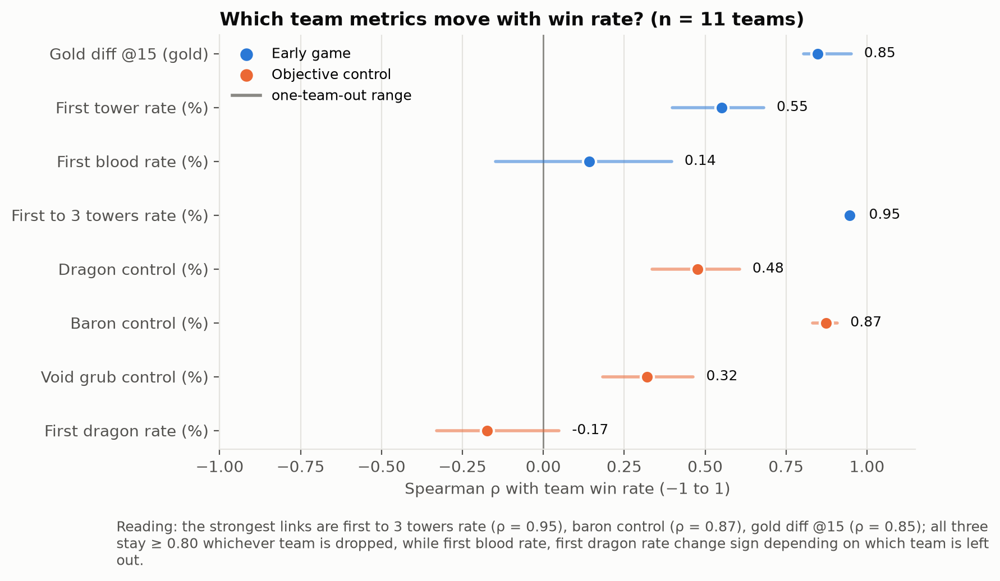
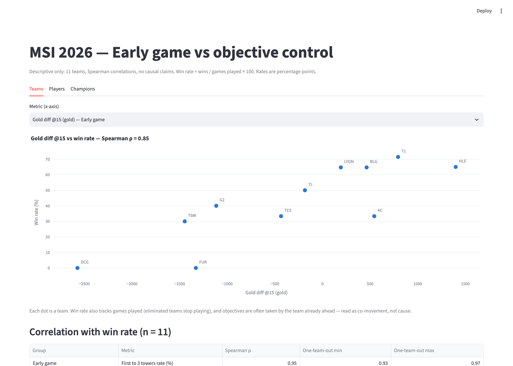

# MSI 2026: Early Game Lead vs Objective Control

**Question:** At MSI 2026, do teams that win more stand out in the early game (gold at 15, first tower) or in objective control (dragons, Baron)?



## Summary
Using team, player and champion statistics from MSI 2026 (11 teams, 71 games), I compared four early-game and four objective-control metrics against team win rate with Spearman correlations and leave-one-team-out checks. Neither group stands out as a block: what separates the winners is a **sustained lead** built by around the middle of the game (gold at 15 minutes, first to three towers, Baron control), while one-off "first" events (first blood, first dragon) barely move with win rate. All results are descriptive. With 11 teams, they show co-movement, not cause.

## Key findings
1. **Teams ahead in gold at minute 15 have higher win rates.** Spearman ρ = 0.85, and it stays between 0.80 and 0.95 whichever team is removed. Teams above 50% win rate averaged +713 gold at 15, the rest −934. Games lasted 32.5 minutes on average, so minute 15 is about 46% of the way through a game: closer to the middle than the opening. (see `figures/03_gold15_vs_winrate.png`)
2. **Baron control moves with win rate just as strongly (ρ = 0.87, 0.83–0.91 one-team-out), but it overlaps with the lead metrics.** It correlates 0.81 with "first to three towers". Barons are usually taken by the team already ahead, so this reads as the same "being ahead" signal, not a separate one. (see `figures/04_baron_vs_winrate.png`)
3. **One-off "first" events do not separate winners.** First blood has ρ = 0.14 and first dragon ρ = −0.17; both change sign depending on which team is left out. First tower looks moderate (0.55) but drops to 0.18 once the two 0–6 teams are removed. (see `figures/02_spearman_by_metric.png`)

Also:
- "First to three towers" has the strongest link (ρ = 0.95). The data has no timestamp for it, so it is reported as early-to-mid game rather than as early-game evidence.
- Average game length does not move with win rate or with any of the eight metrics (largest |ρ| = 0.29).

## Limitations
- **Only 11 teams.** Correlations are descriptive and can shift when a single team is removed; leave-one-out ranges are reported for every metric.
- **Strength-of-schedule bias.** Win rate and games played rank teams almost identically (ρ = 0.96): teams eliminated early played fewer games against different opponents.
- **Reverse causality.** Objectives are often taken *because* a team is already ahead, so no causal claims.
- **Missing timing data.** Event metrics have no timing in the data, and team averages hide game-by-game dynamics.

## Product takeaway
For a team-analytics or broadcast product, "team form" indicators should lean on sustained-lead metrics such as gold difference at a fixed minute rather than one-off "first" stats. In this data, the first group tracks winning far more consistently. (Descriptive, 11 teams; not validated at game level.)

## Dashboard


The dashboard has three tabs:
- **Teams:** metric picker with a labelled scatter and a correlation table.
- **Players:** role and team filters with KDA, gold diff @10 and damage share.
- **Champions:** minimum-games slider (default 5) with a pick+ban vs win rate scatter.

It reads from SQLite, not CSV.

## Data
- Source: [League of Legends MSI 2026 Dataset](https://www.kaggle.com/datasets/stuker/league-of-legends-msi-2026) by Eduardo Stückrath (from Oracle's Elixir, validated with Liquipedia). License: CC BY 4.0
- Data is not included in the repo. Download with:
  `kaggle datasets download -d stuker/league-of-legends-msi-2026 -p data/ --unzip`
- Validation report: `reports/data_validation.md`. It found:
  - 0 duplicate rows.
  - Every player's games played matches their team's.
  - Player kills sum to team kills.
  - Champion games sum to 10 × 71.
  - One minor inconsistency: Pantheon's pick rate.

## Method
- **Validation** (`src/validate.py`): shape, types, missing values, duplicates and cross-table consistency.
- **Cleaning** (`src/clean.py`, log in `reports/cleaning_log.md`):
  - Converted "65%" strings to numbers (0–100 scale).
  - Dropped the 3 champions with 0 games.
  - Rounded floats.
  - Derived `winrate = wins / games_played × 100`.
  - Kept Elder Dragon NaNs as NaN, not 0.
- **Database** (`src/load_db.py`): loaded three tables into SQLite (`data/msi26.db`).
- **SQL** (`sql/queries.sql`, run with `src/run_queries.py`): answered 11 questions using JOIN, GROUP BY, CASE and window functions (RANK, NTILE, ROW_NUMBER, DENSE_RANK, AVG OVER).
- **Analysis** (`notebooks/analysis.ipynb`):
  - Spearman correlation of each metric with win rate.
  - Leave-one-team-out stability, plus a check without the two 6-game teams.
  - Overlap between metrics and game-length context.
  - No p-values or models.
- **Dashboard:** Streamlit (`app/dashboard.py`).

## Reproduce
Tested with Python 3.15.
```
pip install -r requirements.txt
python src/validate.py && python src/clean.py && python src/load_db.py
python src/run_queries.py
jupyter nbconvert --to notebook --execute --inplace notebooks/analysis.ipynb
streamlit run app/dashboard.py
```

## Structure
`data/` (ignored) | `src/` | `sql/` | `notebooks/` | `app/` | `figures/` | `reports/`

## License
- **Code** (`src/`, `sql/`, `app/`, `notebooks/`): MIT, see [`LICENSE`](LICENSE).
- **Data**: not included. The MSI 2026 dataset by Eduardo Stückrath is licensed under [CC BY 4.0](https://creativecommons.org/licenses/by/4.0/). Figures and reports in this repo are derived from it and carry the same attribution.
